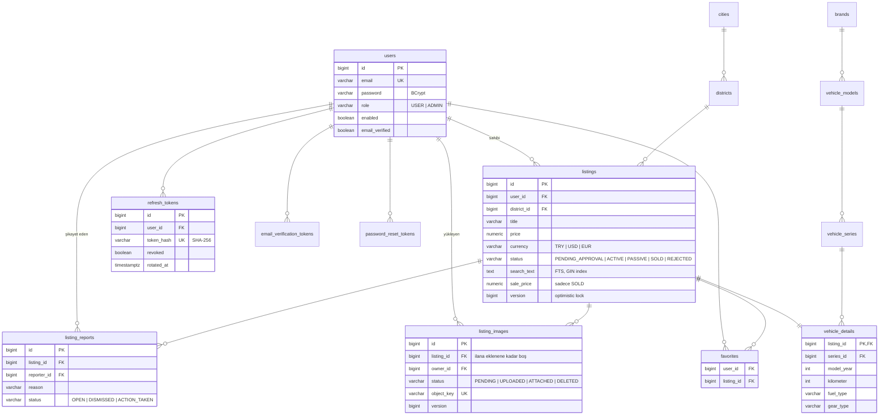

# satmis.com — Backend

[](https://github.com/FeridunSrky/satmis-backend/actions/workflows/ci.yml)

İkinci el araç ilanı platformunun REST API'si. Üniversite bitirme projesi olarak, gerçek bir ürün standartlarında (sürümlü şema, entegrasyon testleri, CI, güvenlik) geliştirildi.

Frontend (React + Vite + TypeScript): [satmis-frontend](https://github.com/FeridunSrky/satmis-frontend)

## Özellikler

- **Hesap:** kayıt, giriş, e-posta doğrulama, şifre sıfırlama, profil. JWT access token + httpOnly cookie'de dönen refresh token.
- **İlanlar:** oluşturma, düzenleme, silme; marka/model/seri, şehir/ilçe, fiyat, yıl, km, yakıt, vites gibi filtreler; anahtar kelime araması; sayfalama ve sıralama.
- **Görseller:** tarayıcıdan doğrudan object storage'a imzalı URL ile yükleme, sunucuda dosya türü kontrolü, sahipsiz dosyaların otomatik temizliği.
- **Favoriler** ve **ilan şikayetleri**.
- **Satış kaydı** ve herkese açık **satılmış araçlar** sayfası (satış fiyatı istatistikleriyle).
- **Admin paneli:** ilan onayı/reddi, şikayet kuyruğu, kullanıcı engelleme, katalog yönetimi, uydurma satışları gizleme.

## Teknolojiler

| Alan | Kullanılan |
|---|---|
| Dil / çatı | Java 21, Spring Boot 4.1 (Spring Framework 7, Spring Security 7, Hibernate 7, Jackson 3) |
| Veri | PostgreSQL 16, Spring Data JPA, Flyway, PostgreSQL full-text search |
| Güvenlik | Spring Security, JWT (jjwt), BCrypt, Bucket4j (rate limiting) |
| Eşleme / doğrulama | MapStruct, Bean Validation, Lombok |
| Depolama / mail | S3 API (AWS SDK v2; dev'de SeaweedFS, prod'da Cloudflare R2), SMTP (dev'de Mailpit) |
| Doküman | springdoc-openapi (Swagger UI) |
| Test | JUnit 5, Mockito, AssertJ, Testcontainers (gerçek PostgreSQL, SeaweedFS, Mailpit) |
| Teslim | Maven, çok aşamalı Dockerfile (root olmayan kullanıcı), GitHub Actions |

## Mimari

Paketleme özellik bazlıdır; her özellik kendi controller, service, repository, entity, mapper ve `dto/` paketini taşır:

```
com.satmis
├── auth       kayıt, giriş, refresh token, e-posta doğrulama, şifre sıfırlama
├── user       profil, admin kullanıcı yönetimi
├── listing    ilan yazma/okuma, arama, görseller, onay, satış
├── vehicle    araç detayları
├── catalog    marka/model/seri, şehir/ilçe (seed + admin ekleme)
├── favorite   favoriler
├── report     ilan şikayetleri ve admin kuyruğu
├── security   JWT filtresi, CORS, rate limiting
├── storage    object storage adapter'ı
├── mail       mail adapter'ı
└── common, config, enums
```

- Katmanlar: Controller → Service → Repository. İş kuralları sadece Service'te.
- Entity'ler API'den dönmez; istek/cevaplar `record` DTO, dönüşüm MapStruct ile. İstemciden gelmemesi gereken alanlar (rol, durum vb.) mapper'da açıkça yok sayılır.
- Tüm hatalar tek bir `@RestControllerAdvice` ile aynı JSON biçiminde döner. Frontend'in durum kodundan ayırt edemeyeceği durumlar ayrıca bir `code` taşır (örn. `EMAIL_NOT_VERIFIED`, `REFRESH_TOKEN_ROTATED`).
- Dış sistemler (depolama, mail) adapter arkasındadır; SDK tipleri ve hataları iş katmanına sızmaz.
- `open-in-view` kapalı; tembel ilişkiler transaction içinde DTO'ya çevrilir.

## Öne çıkan mühendislik kararları

**Liste uçlarında sabit sorgu sayısı.** İlan listeleri iki adımda kurulur: önce filtreye uyan sayfanın id'leri (Specification), sonra bu id'lerin satırları ilişkileriyle birlikte tek join fetch'le. Böylece hem doğru sayfalama yapılır hem N+1 oluşmaz. Sayfa başına sorgu sayısı sabittir ve `ListingIT` bunu ölçer.

**Anahtar kelime araması.** PostgreSQL full-text search, `unaccent` ile (ö/o, ş/s farkı aramayı bozmaz) ve önek eşleşmesiyle. Kullanıcı girdisi önce harf/rakam token'larına ayrılır, ham metin sorguya gitmez. Hibernate'e kaydedilen SQL fonksiyonu GIN index ifadesiyle birebir aynıdır; test, index'in gerçekten kullanıldığını `EXPLAIN` ile kontrol eder.

**Refresh token güvenliği.** Refresh token DB'de sadece SHA-256 hash'i olarak, tarayıcıda httpOnly + `SameSite=Strict` cookie olarak durur. Her kullanımda döndürülür (rotation). Rotasyon koşullu tek bir `UPDATE`'tir: aynı token'la eşzamanlı gelen isteklerden sadece biri kazanır. Kullanılmış bir token 30 sn içinde tekrar gelirse başka sekme sayılır; daha geç gelirse çalınmış sayılır ve kullanıcının tüm oturumları kapatılır. Hata olursa rotasyon geri alınır ve eski cookie geçerli kalır (`RefreshRotationFailureIT`).

**Görsel yükleme.** Dosya sunucudan geçmez: API imzalı bir PUT URL'si verir, tarayıcı dosyayı depoya yükler. Tür, boyut ve önbellek başlığı imzanın parçasıdır. Yükleme bitince sunucu dosyanın ilk byte'larına bakarak gerçek türünü kontrol eder (istemcinin beyanına güvenmez). Görsel durumları `PENDING → UPLOADED → ATTACHED → DELETED`. Dosya silme commit'ten sonra asenkron yapılır; başarısız olursa saatlik iş tekrar dener, 24 saat içinde ilana eklenmeyen görselleri de temizler. DB tek doğruluk kaynağıdır.

**Eşzamanlılık.** İlan güncellemede optimistic locking: istek okuduğu `version`'ı gönderir, arada başkası değiştirdiyse `409`. Admin onayı/reddi de incelenen sürümü ister; sahibi ilanı inceleme sırasında değiştirdiyse karar uygulanmaz. Benzersizlik kuralları (aynı ilana tek açık şikayet, aynı kategoride aynı isim) Service'te kontrol edilir, aynı anda gelen istekleri DB constraint'leri yakalar.

**İş kuralları DB'de de korunur.** Enum kolonlarında `CHECK` constraint'leri var; örneğin ret nedeni sadece `REJECTED` ilanda, satış alanları sadece `SOLD` ilanda dolu olabilir. Uygulamadaki bir hata tutarsız veri yazamaz.

**Moderasyon.** Yeni ilan admin onayına düşer; yayındaki ilanın başlık, açıklama, fiyat veya görselleri değişirse tekrar onaya döner (km gibi alanlar dönmez). Şikayetler otomatik gizleme yapmaz (rakiplerin toplu şikayetle ilan düşürmesini önlemek için); admin ilan bazında gruplanmış kuyruktan karar verir. Engellenen kullanıcının ilanları gizlenir ama silinmez, oturumları kapanır.

**Diğer.**
- Kimlik doğrulama uçları IP başına rate limit'li (`429` + `Retry-After`).
- Şifre sıfırlama kayıtlı olmayan e-postada da aynı cevabı verir; mailler commit'ten sonra asenkron gönderilir, böylece hesabın var olup olmadığı cevaptan ya da süresinden anlaşılmaz.
- Admin rolü hiçbir zaman istemciden alınmaz; ilk admin ortam değişkeniyle atanır.
- Satıcı telefonu sadece giriş yapmış kullanıcıya, sadece ilan detayında döner; e-posta hiçbir uçta dönmez.
- Türkçe sıralama ve büyük/küçük harf karşılaştırması Java'da `Collator` ile yapılır; `I`/`ı` sorunu için dönüşümler `Locale.ROOT` ile.
- Uygulama açılırken eksik ortam değişkenlerini adıyla raporlar.

## Veri modeli

Şema Flyway migration'larıyla yönetilir (`src/main/resources/db/migration`, V1–V11). Hibernate şemayı değiştirmez, sadece entity'lerle uyumunu doğrular. Aşağıda sadeleştirilmiş hali var (zaman damgaları ve bazı araç alanları çıkarıldı).



## Lokal çalıştırma

Gerekenler: JDK 21, Docker. Maven wrapper repoda (`./mvnw`, Windows'ta `mvnw.cmd`).

1. Ortam dosyasını oluşturun ve doldurun:
   ```bash
   cp .env.example .env
   ```
   - `JWT_SECRET`: `openssl rand -base64 32` çıktısı.
   - Veritabanı: makinedeki PostgreSQL için `DB_PASSWORD` yeterli (`satmis` veritabanı oluşturulmuş olmalı). Docker'daki veritabanını kullanmak için `.env.example`'daki `DB_URL`/`DB_USERNAME`/`DB_PASSWORD` satırlarını açın.
   - `APP_ADMIN_EMAILS`: admin olacak hesabın e-postası (kayıt olduktan sonra uygulama yeniden açılınca admin olur).
2. Yardımcı servisleri başlatın:
   ```bash
   docker compose up -d mailpit seaweedfs seaweedfs-init   # Docker'daki DB için: postgres de ekleyin
   ```
3. Uygulamayı başlatın:
   ```bash
   ./mvnw spring-boot:run
   ```
   Açılışta Flyway şemayı kurar, katalog (marka/model/seri, il/ilçe) seed dosyalarından yüklenir.

| Adres | Ne |
|---|---|
| http://localhost:8080/swagger-ui.html | API dokümanı (sadece `dev`) |
| http://localhost:8025 | Mailpit: doğrulama ve şifre sıfırlama mailleri |
| http://localhost:8333/satmis-images/ | Yüklenen görseller (SeaweedFS) |

Profiller: `dev` (lokal, SQL logu ve Swagger açık), `prod` (tüm sırlar ortam değişkeninden, varsayılan yok), `test`. Profil seçilmezse uygulama açılmaz.

## Testler

```bash
./mvnw clean verify
```

Docker açık olmalı. Entegrasyon testleri Testcontainers ile gerçek PostgreSQL 16 (gerekirse SeaweedFS ve Mailpit) açar; H2 gibi gömülü veritabanı kullanılmaz. Toplam 216 test: 45 birim (`*Test`, surefire) ve 171 entegrasyon (`*IT`, failsafe). Entegrasyon testleri boş veritabanında tüm migration'ları çalıştırıp şemayı doğrulayarak başlar.

CI (GitHub Actions) her push ve PR'da `clean verify` çalıştırır, ardından Docker imajını build eder.

## Docker

```bash
docker build -t satmis-backend .
```

Çok aşamalı imaj: build aşamasında JDK + Maven, çalışma aşamasında sadece JRE ve root olmayan `spring` kullanıcısı. İmaj `prod` profiliyle açılır; gerekli değişkenler `.env.example`'ın sonunda listelidir.

## Dokümanlar

- [`docs/frontend-api.md`](docs/frontend-api.md): frontend için API sözleşmesi (uçlar, hata kodları, auth ve refresh akışı, görsel yükleme).
- `docs/frontend-gorev-*.md`: frontend'e verilen özellik görev belgeleri.
